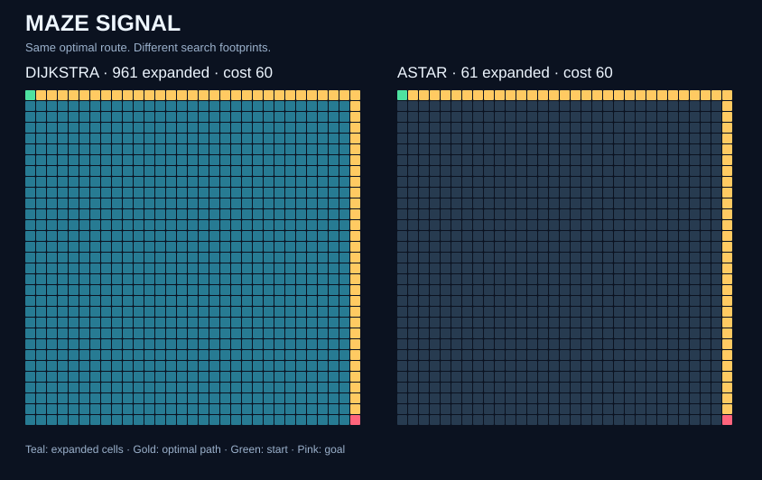

<div align="center">

# Maze Signal

### The shortest route isn't always the cheapest.

**An optimal pathfinding challenge in Python & C — with reproducible experiments.**

[](https://github.com/mohammmad357/maze-signal/actions/workflows/ci.yml)


[](LICENSE)



[Quick start](#quick-start) · [The challenge](#the-challenge) · [Measured results](results/RESULTS.md) · [فارسی](README.fa.md)

</div>

## Try the browser demo

[Open the live editor](https://mohammmad357.github.io/maze-signal/) — no installation. Paint walls and weights, move endpoints, then compare Dijkstra and A* on the same map. Includes keyboard controls, pause/reset, a no-route example and a Persian guide.

[Watch the 60-second tour](https://mohammmad357.github.io/maze-signal/intro.gif) · [Demo contract and verification](docs/README.md)

The JavaScript implementation matches 505 fixed/seeded Python/C map fixtures (1010 algorithm comparisons). The browser compares optimal cost and expanded cells; animation speed is not a Python/C benchmark. The tour is an algorithm-generated silent GIF.

## The challenge

Find the **minimum-cost route**, moving up, down, left or right. Walls block movement; expensive terrain can make a longer route cheaper.

```text
3 5
S999G
.###.
.....
```

The direct route takes 4 moves and costs **28**. The detour takes 8 moves and costs **8**. A shortest-by-move-count solution chooses badly here.

Can you find the cheapest route, prove it is optimal, and reduce the amount of the map you explore?

This repository answers with **Dijkstra** and **A\***, implemented independently in Python and C11. Both use binary heaps and the same deterministic tie order. No runtime libraries beyond Python's standard library and the C standard library are needed.

## Quick start

Python 3.11+; GCC or a compatible C11 compiler for the native version.

```bash
git clone https://github.com/mohammmad357/maze-signal.git
cd maze-signal
python python/solver.py maps/trap.txt astar
```

Build and run C on Linux/macOS:

```bash
mkdir -p build
gcc -std=c11 -O3 -Wall -Wextra -Wpedantic c/solver.c -o build/solver
./build/solver maps/trap.txt astar
python -m unittest discover -s tests -v
```

Windows PowerShell:

```powershell
New-Item -ItemType Directory -Force build | Out-Null
gcc -std=c11 -O3 -Wall -Wextra -Wpedantic c/solver.c -o build/solver.exe
./build/solver.exe maps/trap.txt astar
python -m unittest discover -s tests -v
```

The JSON output reports `cost`, `expanded`, `path` and `seconds`. Path entries are zero-based row-major cell indices: `row = index // width`, `column = index % width`. Unreachable goals produce `cost: null` and an empty path, with successful exit status. Invalid input produces a nonzero exit status.

## Input contract

First line: `height width`, each in **1..1024**. Then exactly `height` rows of `width` cells. LF and CRLF are supported.

| Cell | Meaning | Cost to enter |
|---|---|---:|
| `S` | One start | 1, if entered later |
| `G` | One goal | 1 |
| `.` | Ordinary terrain | 1 |
| `1`..`9` | Weighted terrain | Digit value |
| `#` | Wall | Impassable |

Exactly one `S` and one `G` are required. The starting cell has initial cost zero. Diagonals, zero/negative weights, multiple endpoints and blank grid rows are unsupported. `S` and `G` occupy distinct cells.

## Why the answer is optimal

Dijkstra prioritizes the cost so far, `g`. A* prioritizes `f = g + h`, where `h` is Manhattan distance to the goal. Every move costs at least one, so this heuristic never overestimates. It is also consistent: moving one step changes Manhattan distance by at most one, no more than that move's cost. A popped, non-stale goal therefore has optimal cost, and closed nodes need no reopening.

Both versions discard stale heap entries. Ties favor larger `g`, then smaller cell index. This choice strongly helps A* on open grids and is explicitly part of the experiment. Different tie policies can give different search footprints and equally optimal paths.

On a four-neighbor grid, `E = O(V)`. Worst-case time is **O(V log V)** and memory **O(V)**, including lazy duplicate heap entries. Positive costs prevent parent cycles. Integer distances in C fit within the configured size limit: even a simple path of 1,048,576 cells at cost 9 stays well below `INT_MAX`.

## Experiments you can reproduce

Three seeded workloads: an open grid, alternating wall barriers, and random weighted terrain. The weighted map generator opens blocked cells along a boundary route so the goal is reachable; the barriers are deterministic. The hero image is the **31 × 31 open demo**, not a screenshot of the larger benchmark.

```bash
python tools/experiment.py --binary build/solver --size 160 --repeat 30 --samples 5
```

On Windows, use `--binary build/solver.exe`.

The script rebuilds maps, the hero SVG, [raw timing samples](results/raw.csv), [environment metadata](results/environment.json) and the [results report](results/RESULTS.md). Measurements exclude map parsing, executable startup and JSON printing. Search allocations remain included; the Python solver also collects visitation order for rendering.

**Read the numbers in context:** A* benefits from an informative heuristic. Walls and expensive terrain can weaken that advantage. Benchmarks here illustrate those effects; they do not establish universal speedups between languages or algorithms.

On the committed **160 × 160 open grid**, A* expands **319** cells while Dijkstra expands **25,600**, an **80.25× reduction**, at the same optimal cost of **318**. On the barrier map, the reduction is only about **1.8%**. Fewer expansions can still take more time because of heuristic and heap overhead; consult the full timing table for both languages.

C timing batches adapt toward 200 ms to reduce clock quantization; every batch's actual repeat count is stored in the raw CSV.

## Correctness checks

The suite compares **500 seeded random maps** and five fixed cases against an independent Bellman-Ford reference. For each map it verifies both languages and both algorithms, path adjacency, path cost, endpoint validity and deterministic expansion counts. Additional malformed-input checks cover invalid dimensions, cells, endpoints and extra data.

GitHub Actions builds C with warnings treated as errors, runs the suite on Python 3.11 and 3.13, then repeats with address and undefined-behavior sanitizers on Linux. Local validation and remote CI status are separate; the badge reflects the latest remote run.

## Explore further

- Add a bidirectional search and measure where it wins.
- Compare tie policies on the same fixed maps.
- Add diagonal moves and derive an admissible heuristic for their costs.
- Implement an indexed heap and measure memory as well as runtime.
- Create adversarial maps where Manhattan distance gives almost no help.

## Layout

```text
python/solver.py       Readable standard-library implementation
c/solver.c            C11 implementation with a growable binary heap
tests/test_solver.py  Independent reference and differential checks
tools/experiment.py   Deterministic maps, timings and SVG rendering
maps/                 Small examples and committed benchmark inputs
assets/search.svg     Algorithm-generated hero visual
results/              Report, raw samples and environment metadata
```

## Further reading

[Red Blob Games: Introduction to A*](https://www.redblobgames.com/pathfinding/a-star/introduction.html) is an excellent visual explanation of weighted graph search and heuristics. The implementations, tests and assets here are original to this project; no external code or artwork is bundled.

MIT licensed. Contributions that include correctness evidence and reproducible measurements are welcome.

## Help improve this project

Try the quick start, report a reproducible issue, or pick a small documentation improvement.
See [CONTRIBUTING.md](CONTRIBUTING.md) for reporting details, development checks and evidence expected for changes.
