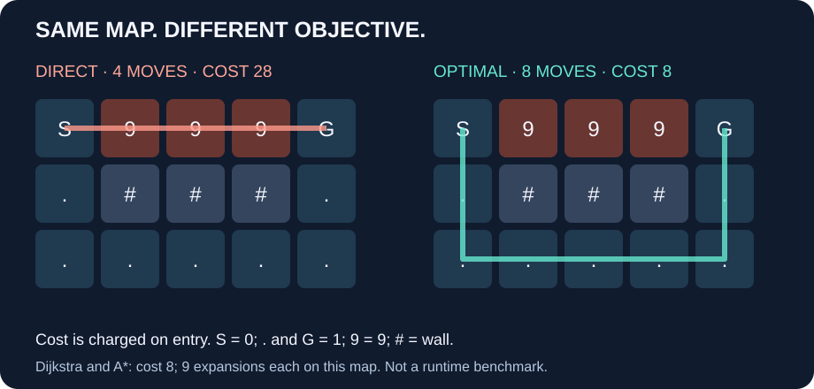

# Four moves cost 28. Eight moves cost 8.

Published 2026-10-11 as the week-nine content task of a 90-day plan, prepared early; nine calendar weeks have not elapsed.



**Count the cost of entering cells, not just the number of moves.** S costs zero; G and `.` cost one; each `9` costs nine. Moves are horizontal or vertical. `#` is a wall.

```text
3 5
S999G
.###.
.....
```

The direct route takes four moves: `9+9+9+1 = 28`. The detour takes eight: `1+1+1+1+1+1+1+1 = 8`.
Both Dijkstra and A* return cost **8**, with **9 expanded nodes including the goal**, under this implementation's ordering. This example does not show fewer expansions for A*; heuristic guidance is not a guarantee of less work on every map.

## Try it in 30 seconds

1. Open the [live demo](https://mohammmad357.github.io/maze-signal/).
2. Select **Weighted detour**, then **Run comparison**.
3. Both panels should show cost **8** and route length **8**. Turn the three `9` cells into weight `1` and rerun: both should choose cost **4**.

If Pages cannot be reached on your network, use the [CLI quick start](https://github.com/mohammmad357/maze-signal#quick-start), then from the repository root:

```sh
python python/solver.py maps/trap.txt dijkstra
python python/solver.py maps/trap.txt astar
```

The committed [fixture](https://github.com/mohammmad357/maze-signal/blob/ae9b58191a42027773c1b67d8eb66471a64842ec/docs/fixtures.json) contains this exact path: `0,5,10,11,12,13,14,9,4` (row-major cell indices). Expanded nodes measure search work, not elapsed time or a Python/C speedup. Prepared with AI assistance and checked against executable solver output.

**فارسی:** کوتاه‌ترین مسیر از نظر تعداد حرکت، همیشه کم‌هزینه‌ترین مسیر نیست. در این نقشه مسیر مستقیم ۲۸ و مسیر دورتر ۸ هزینه دارد. هر دو الگوریتم هزینهٔ بهینهٔ ۸ را پیدا می‌کنند؛ این مثال ادعای برتری همیشگی A* ندارد.
